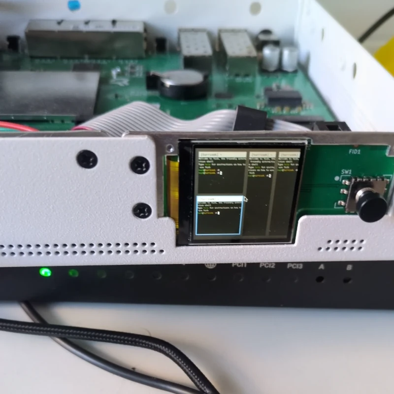
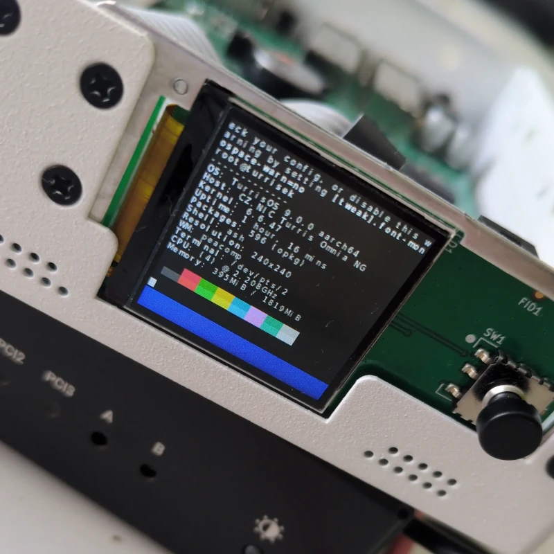
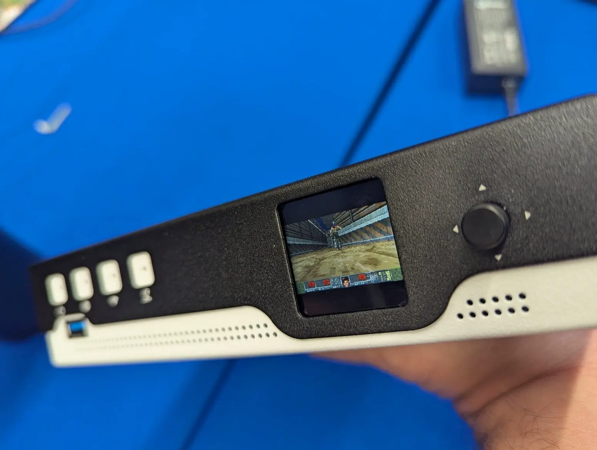

# Customizing status display

Omnia NG contains a 240x240 display intended for showing quick stats and information to the user and offering basic controls.

Out-of-the-box, Omnia NG is shipped with status program called [PeacockR](https://gitlab.nic.cz/turris/peacockr), which 
should cover all basic needs for a router status display, but thanks to the use of the Wayland protocol, implemented by our
in-house Wayland compositor [Peacomp](https://gitlab.nic.cz/turris/peacomp), customization options are basically limitless[^1].

[^1]: We do not ship Mesa so all graphics has to be rasterised by the client. If you wish to run graphical acceleration-requiring
      programs, you can create a [LXC container](../lxc/lxc.md) and pass-through the Wayland socket or package Mesa yourself. This
      is not supported in any way.

## Customizing PeacockR Menu

If you navigate to the right, you enter a menu. This menu can be rearranged, items can be added or removed, including
custom actions.

Configuration for PeacockR is written in [KDLv2](https://kdl.dev) and it is loaded from file `/etc/peacockr/config.kdl`.
Currently, the only configuration option available is the `menu` node, describing the entries.

```rs
// Example menu
menu {
	entry {
		// Every menu entry has a mandatory title
		title "Snapshots"
		// We can launch one of internal action. This one navigates to snapshot manager page.
		internal schnapps
	}

	entry {
		title "Run Updater"

		// We can spawn processes. If we set `console=#true` property,
		// process will be spawned inside a console window, where
		// we can interact with it.
		//
		// Spawn does not perform any preprocessing, arguments are passed verbatim.
		spawn console=#true { pkgupdate }
	}

	entry {
		title "Custom Scripts"

		// We can even have submenus
		menu {
			entry {
				title "Post Hello"
				
				// We can also launch a shell script using `/bin/sh`.
				//
				// Console parameter is accepted as well.
				shell """
					message="hello, world!"
					create_notification -t -s news "${message}"
				"""
			}
		}
	}
}
```

(you can also see KDL schema [here](https://gitlab.nic.cz/turris/peacockr/-/blob/72ae20213966ef4c2f8b535e1dc6e43fe924eaca/docs/schema.kdl))

Shell scripts are not passed as argument or using `stdin`, they are on startup loaded in memory object, which is then passed to the shell as inherited file descriptor.

[Foot](https://codeberg.org/dnkl/foot) is used as the terminal emulator.

### Internal Actions
- `schnapps`: Navigate to Schnapps Snapshot Manager

!!! warning
	Due to used udev implementation, there are certain limitations and one of them is
	that udev does not report correctly newly plugged devices. So if you wish to connect
	a keyboard during runtime, you have to restart the Wayland compositor in order to be
	detected. We are working on a fix.

## Running graphical programs
As we run a Wayland compositor, you can also run other graphical programs. If you run them through PeacockR, path to the compositor is inherited automatically.

If you wish to replace the display program, you can disable the `peacockr` service using `/etc/init.d/peacockr disable` and then run your own program. The Wayland socket should be located at `/run/root/wayland-1` so do not forget to set the `WAYLAND_DISPLAY` environment variable.

Currently implemented Wayland protocol extensions are: `linux-dmabuf-v1`, `xdg-shell` and `xdg-decoration-unstable-v1`[^2].

XWayland support is not planned.

[^2]: We do not draw any decorations by ourselves, it is implemented, so clients supporting this protocol extension do not
      try to draw decorations themselves, as on such small resolution it can cause issues.

<figure markdown="span" style="display: inline-block; width:240px">

<figcaption>Running <a href="https://yalter.github.io/niri" target="_blank">Niri</a> nested compositor with few terminal windows tiled</figcaption>
</figure>

<figure markdown="span" style="display: inline-block; width:240px">

<figcaption>Running fastfetch-like program in a terminal</figcaption>
</figure>

### Keycodes
|     Button      | XKB Keycode |
|:---------------:|:------------|
|   D-Pad Left    | Left        |
|   D-Pad Right   | Right       |
|    D-Pad Up     | Up          |
|   D-Pad Down    | Down        |
|   D-Pad Press   | Return      |
| Back Button[^3] | F1          |

[^3]: Next to USB port

## Can it run DOOM?

*Credits: [root.cz](https://root.cz)*